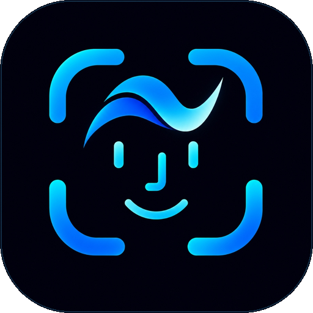

<p align="center">
  
</p>

# NEELx — Fast, Hardened 3D Biometric Face Unlock for macOS & Windows 11

<p align="center">
  <a href="https://github.com/ChandranilDas/NEELx/releases"></a>
  <a href="https://github.com/ChandranilDas/NEELx/releases"></a>
  
  <a href="https://chandranildas.github.io/NEELx/"></a>
  <a href="LICENSE"></a>
</p>

**NEELx** brings fast, natural, 3D biometric Face Unlock to **macOS** and **Windows 11** using any standard built-in or USB RGB webcam — **no IR camera required, 100% offline, hardware-encrypted at rest, and open-source (MIT License).**

> **Official Website:** [https://chandranildas.github.io/NEELx/](https://chandranildas.github.io/NEELx/)  
> **macOS:** macOS 15+ — Native Universal Binary (`arm64` + `x86_64`) for **Apple Silicon (M1, M2, M3, M4, M5 & all newer chips)** + Intel Macs.  
> **Windows 11:** Windows 11 (22H2+, x64 & ARM64) — `.NET 8` WPF Dark Mica + **ONNX Runtime DirectML** (DirectX 12 GPU / Copilot+ NPU) + **Windows DPAPI**.

---

## 🎯 About NEELx & Visual Identity

NEELx runs completely offline on your device with zero cloud servers and zero telemetry. Each operating system gets a **bespoke native visual language** crafted specifically for its platform:

- **macOS Edition — Notch Face ID**: Expands smoothly out of the MacBook hardware notch with an iPhone/iPad Pro-inspired 80-tick 360° enrollment ring, live Lighting Readiness Meter, emerald checkmark dissolve, and Force Touch haptic feedback.
- **Windows 11 Edition — Fluent Prism Horizon**: Intentionally distinct from macOS/iOS — a razor-thin top-edge dark Mica glass blade featuring a counter-rotating **faceted diamond-iris crystal** and a sweeping **horizontal aurora laser horizon** that snaps to 0° emerald crystal alignment upon verified unlock.

---

## ✨ Key Features

### 🍎 NEELx for macOS 15+
- **Floating "Welcome Back (Name)!" Unlock Notification**: Shows a sleek, non-intrusive floating glass pill at the top of the screen (`"Welcome Back, <Name>!"`) with a subtle spring entrance and graceful retreat right after successful face authorization (includes settings toggle and 1-click live preview in Settings → General).
- **Smooth 360° Circular Face Enrollment + Live Lighting Readiness Meter**: Slowly roll your head in one natural circle while a live micro-pill (`Ideal Lighting` / `Backlit · HDR Active` / `Low Light · Studio Fill`) guides optimal 512-D ArcFace + **9-zone 3D depth** capture.
- **Face ID for System Touch ID & Password Prompts**: Approves macOS Touch ID & admin password prompts everywhere — System Settings, app/pkg installers, Saved Passwords (Safari, Chrome, Passwords app), Finder, and Keychain — while strictly excluding Apple Pay, payments, and FileVault.
- **Stage 3 Neural 3D Depth + Multi-Frame Temporal Consistency (Apple Neural Engine)**: Runs Apple's Core ML `DepthAnythingV2SmallF16` in FP16 (~22.6 ms on ANE), validating nose protrusion, non-planar surface curvature, head-to-background cliff, and **2 consecutive physically consistent 3D frames**.
- **Backlit Window HDR Shadow Recovery**: GPU Core Image tone mapping (`CIHighlightShadowAdjust`) lifts crushed facial shadows when sitting with a bright sunlit window behind you.
- **Luxury Studio Light Softbox & Spectral Chromatic Rim (with Live Preview)**: Crystal-clear screen center surrounded by a 3800K warm champagne perimeter softbox + softened pastel cyan/magenta reflection check against 4K video replay. Preview anytime via **Settings → General → Preview**.
- **Subtle Spatial Haptic + Optional Soft Glass Sound Cue**: Trackpad `.alignment` haptic + optional muted Glass chime (off by default).
- **iPhone & iPad Pro Continuity Studio (Desk Stand / Studio Optics)**: Seamlessly use your iPhone (iOS 16+) or iPad Pro camera for studio-quality 4K optics, dual-path concurrent unlock, and Bluetooth LE arm's-reach proximity gating (< 1.5m). Works on any standard desk stand, wireless charger, kickstand case, or monitor mount — no proprietary laptop clip required! Includes live hardware cross-checks.
- **Attention & Eye Gaze Verification**: Checks open eyes (`EAR`) and active gaze before unlocking.
- **Hardcoded Zero-Compromise Security**: 3D Neural Depth (ANE), Eye Gaze, and Multi-Frame Anti-Spoofing are hardcoded active so security cannot be accidentally disabled.
- **Silent Adaptive Learning, Encrypted Intruder Log, Walk-Away Auto-Lock & Smart Clamshell Camera**.
- **Auto Local-Cert Signing & 1-Click GitHub Auto-Updater**: Preserves your own free local `Apple Development` certificate on upgrades so macOS Accessibility & Keychain permissions stay intact.

### 🪟 NEELx for Windows 11 (Fluent Prism Edition)
- **Floating "Welcome Back (Name)!" Unlock Notification**: Displays a minimal top-edge dark acrylic capsule with emerald checkmark and smooth cubic slide-down/up animation right after verified facial unlock (includes settings toggle and 1-click preview).
- **Original Fluent Prism Horizon Unlock Blade (`PrismHorizonOverlay`)**: Dedicated top-edge dark Mica glass overlay with counter-rotating faceted diamond-iris aperture, horizontal aurora laser sweep, and four distinct states (`Scanning 3D Depth`, `Backlit HDR Lift`, `Verified Unlock`, `2D Spoof Blocked`) — live-previewable right inside `NEELx.Windows.exe`.
- **ONNX Runtime DirectML GPU/NPU Engine (`OnnxFaceEngine`)**: Runs 512-D ArcFace + `DepthAnythingV2Small` on any DirectX 12 GPU (Intel Iris Xe/Arc, AMD Radeon, NVIDIA RTX/GTX) or Copilot+ NPU, with automatic CPU fallback.
- **Multi-Frame Temporal 3D Depth Consistency**: Enforces 2 consecutive physically consistent 3D depth frames (nose protrusion `>= 0.042`, curvature RMSE `>= 0.024`, head-to-background cliff `>= 0.065`) to block flat photos, phone displays, and transient glare.
- **Backlit Window HDR Shadow Recovery**: Real-time center-vs-border luminance detector automatically lifts silhouetted dark faces sitting in front of bright windows.
- **Windows DPAPI Offline Credential Vault (`DpapiCredentialVault`)**: Encrypts your 512-D identity vector and 9-zone 3D baseline offline under `ProtectedData.Protect` (`DataProtectionScope.CurrentUser`) in `%LOCALAPPDATA%\NEELx`.
- **WinLogon Lock Screen Architecture (`NEELx.CredentialProvider`)**: Native C++ `ICredentialProvider` COM interface communicating with `NEELx.Windows.exe` over an ACL-hardened named pipe (`\\.\pipe\NEELxBiometricUnlock`) restricted to `SYSTEM` + active user SID.
- **Phone Camera Studio (Android 14+ USB Webcam & iPhone Video)**: Use your phone's camera via native USB-C webcam mode or wireless camera on any desk stand or kickstand — zero laptop clip required! Includes Bluetooth LE proximity gating (< 1.5m).
- **Standalone Zero-Dependency Distribution**: Available as a complete, self-contained standalone package (unzip & double-click `Run-NEELx.bat` or run the 1-click PowerShell command; zero prerequisites, zero secondary runtime or model downloads).

---

## 🚀 Quick Start & Terminal Commands

### 🍎 macOS 15+

#### Requirements
- **macOS 15.0 (Sequoia)** or later
- **Apple Silicon (M1, M2, M3, M4, M5 & newer)** or **Intel Mac** (no upper chip limit)
- Built-in FaceTime HD / Center Stage camera or external USB / Continuity webcam

#### Method 1: 1-Click Terminal Quick Install (Recommended — Zero Gatekeeper Blocks)
Downloads the pre-bundled all-in-one package, automatically clears macOS Gatekeeper quarantine (`xattr -cr`), installs to `/Applications`, and launches automatically:
```bash
curl -fsSL https://chandranildas.github.io/NEELx/install.sh | bash
```

#### Method 2: Install via Homebrew Cask
```bash
brew tap ChandranilDas/NEELx https://github.com/ChandranilDas/NEELx
brew install --cask neelx
```

#### Method 3: Build Directly from Pure Swift Source
```bash
git clone https://github.com/ChandranilDas/NEELx.git
cd NEELx
chmod +x build.sh
./build.sh --with-depth --install
```

### 📋 Step-by-Step Guide for Mac Users
1. **Install:** Run the 1-click terminal command above (or install via Homebrew). It bypasses browser quarantine automatically so the app opens instantly with zero alerts.
2. **Setup Face & Password:** When prompted, allow camera access. Slowly roll your head in a natural 360° circle while the live meter captures 9 poses and your 3D depth profile. Enter your Mac password once to save it to your local hardware Touch ID Keychain vault.
3. **Instant 3D Unlock:** Press `Cmd + Ctrl + Q` to lock your Mac. Sit in front of your display: NEELx verifies your 3D facial structure in ~25ms on the Neural Engine and unlocks instantly!
4. **Uninstall (if needed):** In the menu bar, click NEELx → **Quit**, then run:
   ```bash
   curl -fsSL https://chandranildas.github.io/NEELx/uninstall.sh | bash
   ```

---

### 🪟 Windows 11 (Fluent Prism Edition)

#### Requirements
- **Windows 11 (22H2 or newer)** — x64 or ARM64
- Any built-in or USB RGB webcam (720p+ recommended, **no Windows Hello IR camera required**)
- Any DirectX 12 GPU or Windows NPU for DirectML acceleration (CPU fallback built in)

#### Method 1: 1-Click SHA-256 Verified PowerShell Installer (Recommended — Zero SmartScreen Blocks)
Verifies the official SHA-256 checksum automatically, unblocks files from Windows Defender (`Unblock-File`), installs per-user under `%LOCALAPPDATA%\NEELx-App` (zero admin required), creates a Start Menu shortcut with the official NEELx logo, and preserves 100% of your DPAPI biometric vault in `%LOCALAPPDATA%\NEELx` on every upgrade:
```powershell
irm https://chandranildas.github.io/NEELx/install.ps1 | iex
```
*(Clean rollback / uninstaller preserving your vault by default: `irm https://raw.githubusercontent.com/ChandranilDas/NEELx/main/windows/uninstall.ps1 | iex`)*

#### Method 2: Download All-in-One Standalone ZIP Directly
Download from the [**Official Website**](https://chandranildas.github.io/NEELx/#download) or [**GitHub Releases**](https://github.com/ChandranilDas/NEELx/releases):
- **`NEELx-v2.0.0-beta.10-windows-x64-portable.zip`** (~85.7 MB — complete self-contained package; pre-bundles .NET 8 runtime, DirectML GPU/NPU 3D engine, ONNX models, and `Run-NEELx.bat`; zero extra runtime or model downloads)

> **💡 First time opening on Windows 11?** Double-click `Run-NEELx.bat` inside the unzipped folder, or click **"More info" → "Run anyway"** if SmartScreen appears.

### 📋 Step-by-Step Guide for Windows Users
1. **Download & Install:** Run the 1-click PowerShell command above (or unzip the standalone ZIP to any folder and double-click `Run-NEELx.bat`).
2. **Setup Face & DPAPI Vault:** Select your webcam in Settings, position your face inside the alignment guide, and follow the on-screen steps. Enter your Windows login password once to encrypt it safely into your local Windows DPAPI vault in `%LOCALAPPDATA%\NEELx`.
3. **Instant 3D Unlock:** Press `Win + L` to lock your PC. Look at your webcam: NEELx's dedicated Prism Horizon laser verifies your 3D depth and automatically logs you in!

#### Method 3: Build & Run Directly from `.NET 8` Source
```powershell
git clone https://github.com/ChandranilDas/NEELx.git
cd NEELx\windows
dotnet restore NEELx.Windows.sln
dotnet build NEELx.Windows.sln -c Release
dotnet run --project src\NEELx.App\NEELx.App.csproj -c Release
```

#### Verify Windows ZIP Integrity (Public SHA-256 Checksum)
```powershell
Get-FileHash "$HOME\Downloads\NEELx-v2.0.0-beta.10-windows-x64-portable.zip" -Algorithm SHA256
```

> Full Windows Credential Provider & DirectML guide: [`windows/README.md`](windows/README.md)

---

## 🔒 Security Architecture & Threat Model

| Security Layer | macOS 15+ Implementation | Windows 11 Implementation |
| :--- | :--- | :--- |
| **Unlock Visual Language** | Notch Face ID 80-tick circular ring + emerald checkmark | Original **Fluent Prism Horizon** top-edge Mica blade + faceted diamond-iris + laser sweep |
| **Identity Matching** | 512-D ArcFace Core ML (ANE, `threshold = 0.63`) | 512-D ArcFace ONNX DirectML GPU/NPU (CPU fallback) |
| **3D Neural Depth** | Core ML `DepthAnythingV2SmallF16` (FP16 ANE, ~22.6 ms) | ONNX `DepthAnythingV2Small` (DirectML, ~28 ms) |
| **Multi-Frame Guard** | 2 consecutive physically consistent 3D frames + 9-zone profile | 2 consecutive physically consistent 3D frames (nose protrusion + curvature + cliff) |
| **Backlit & Dark Rooms** | GPU Core Image HDR shadow lift + 3800K Studio Light & Spectral Rim | Real-time center-vs-border backlit gamma shadow lift + Fluent edge light |
| **Credential Storage** | AES-256-GCM + macOS Keychain (`WhenUnlockedThisDeviceOnly`) + Touch ID | Windows DPAPI (`ProtectedData` CurrentUser) in `%LOCALAPPDATA%\NEELx` |
| **System / Lock Integration** | Lock Screen + System Touch ID & Password Prompts (Apple Pay excluded) | Desktop Biometric App + WinLogon `ICredentialProvider` named-pipe bridge |

> **Transparency Note**: Standard webcams capture 2D RGB frames rather than infrared dot projections (TrueDepth / Windows Hello IR). NEELx maximizes security within 2D webcam limits using 512-D ArcFace, Stage 3 monocular 3D Depth, multi-frame temporal depth consistency, eye attention checks, and anti-replay heuristics.

---

## 🛠️ Required OS Permissions

### macOS 15+
1. **Camera**: Used strictly on-device during enrollment, Lock Screen unlock, and system auth prompts.
2. **Accessibility**: Allows NEELx to securely enter your decrypted password into macOS login and system authorization prompts upon verified 3D Face ID match.

### Windows 11
1. **Camera** (`Settings → Privacy & security → Camera`): Allows `NEELx.Windows.exe` to capture local webcam frames on-device.
2. **Administrator (Optional — WinLogon Lock Screen only)**: Only needed if registering the optional C++ `ICredentialProvider` COM DLL under `HKLM\SOFTWARE\Microsoft\Windows\CurrentVersion\Authentication\Credential Providers`.

---

## 🗺️ Roadmap

### macOS 15+
- [x] 360° Circular Notch Face Enrollment + Live Lighting Readiness Meter
- [x] Sub-200ms Unlock Pipeline + 3ms Keystroke Injection
- [x] Eye Gaze & Attention Verification
- [x] Luxury Studio Light Softbox & Spectral Chromatic Rim (with Live Preview)
- [x] Backlit Window HDR Shadow Recovery
- [x] Face ID for System Touch ID & Password Prompts (Apple Pay excluded)
- [x] Stage 3 Neural 3D Depth + Multi-Frame Temporal Consistency (Apple Silicon ANE)
- [x] Subtle Spatial Haptic + Optional Soft Glass Sound Cue
- [x] Universal Binary (Apple Silicon M1–M5+ & Intel), Homebrew Cask & Auto-Updater

### Windows 11 (Fluent Prism Edition)
- [x] Bespoke Fluent Prism Horizon Top-Edge Unlock Overlay (WPF Dark Mica)
- [x] ONNX Runtime DirectML GPU/NPU 3D Depth + Multi-Frame Temporal Consistency
- [x] Backlit Window HDR Shadow Recovery + Built-In 2D Spoof Rejection Self-Check
- [x] Windows DPAPI Offline Biometric Vault (`DataProtectionScope.CurrentUser`)
- [x] WinLogon `ICredentialProvider` COM Interface + ACL Named-Pipe Bridge
- [x] Automated Windows CI Release Packages (Standalone Portable & Lite ZIPs)
- [x] 1-Click SHA-256 Verified PowerShell Installer (`install.ps1` / `uninstall.ps1`) & Upgrade-Safe DPAPI Vault

---

## 🤝 Contributing & Feedback

Contributions, bug reports, security audits, and test results across **macOS (Apple Silicon M1, M2, M3, M4, M5 & newer, Intel Macs, external webcams)** and **Windows 11 laptops/desktops** are very welcome!
- Send feedback directly (with screenshots) from the [**Official Website**](https://chandranildas.github.io/NEELx/#feedback), from inside the macOS app via **Menu Bar → Send Feedback…**, or open a [GitHub Issue](https://github.com/ChandranilDas/NEELx/issues).

---

## 📄 License & Credits

Released under the **MIT License** — see [LICENSE](LICENSE).  
NEELx is built upon and heavily evolved from [Glance](https://github.com/jonnyoo/glance) by Jonathan Zhou.
