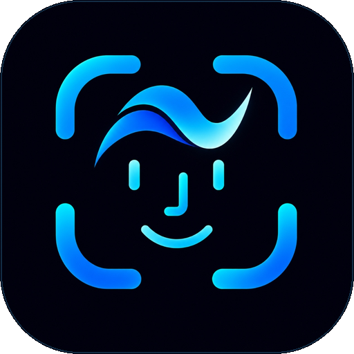

<p align="center">
  
</p>

# NEELx for Windows 11 (Fluent Prism Edition)

**100% offline 3D biometric Face Unlock for Windows 11 laptops and desktops with any standard RGB webcam — no Windows Hello IR camera required.**

> **Official Website:** [https://chandranildas.github.io/NEELx/#download](https://chandranildas.github.io/NEELx/#download)  
> **GitHub Releases:** [https://github.com/ChandranilDas/NEELx/releases](https://github.com/ChandranilDas/NEELx/releases)

---

## 🎯 About the Fluent Prism Horizon Design

Unlike NEELx for macOS (which uses an iPhone/iPad Pro-inspired circular notch Face ID animation), **NEELx for Windows 11** features a completely original **Fluent Prism Horizon** design built natively for Windows 11 Mica/Acrylic glass:

- **Phase 01 · Prism Scanning**: A razor-thin frosted dark-Mica blade docks beneath the top screen edge with two counter-rotating **faceted crystalline diamonds** and a sweeping **cyan-indigo horizontal laser horizon**.
- **Phase 02 · Backlit HDR Lift**: When sitting with a bright window behind you, the rim transitions to warm amber-cyan while real-time gamma tone lifting recovers facial geometry.
- **Phase 03 · Verified Unlock**: Both faceted crystals snap cleanly to 0° **emerald crystal alignment**, locking the horizontal horizon beam solid emerald as DPAPI unlocks your session.
- **Phase 04 · 2D Spoof Rejected**: Flat photos or phone displays fail 3D nose protrusion and depth-cliff checks, pulsing refined amber-rose (`BLOCKED`) without unlocking.

You can preview all four live states immediately after launching `NEELx.Windows.exe` directly from the dashboard.

---

## ✨ Key Features

- **Original Fluent Prism Horizon Overlay (`UI/PrismHorizonOverlay.xaml`)**: Native WPF transparent top-most blade crafted for Windows 11 Dark Mica.
- **ONNX Runtime DirectML GPU/NPU Engine (`Biometrics/OnnxFaceEngine.cs`)**: Runs 512-D `ArcFace` + `DepthAnythingV2Small` on any DirectX 12 GPU (Intel Iris Xe/Arc, AMD Radeon, NVIDIA RTX/GTX) or Copilot+ NPU, falling back automatically to CPU.
- **Multi-Frame Temporal 3D Depth Consistency**: Requires 2 consecutive physically consistent 3D frames (stable nose protrusion `< 0.065` delta, stable head-to-background cliff `< 0.25` delta) within 1600 ms.
- **Backlit Window HDR Shadow Recovery**: Compares center face luminance vs outer border luminance and lifts shadowed silhouettes automatically.
- **Windows DPAPI Encrypted Vault (`Security/DpapiCredentialVault.cs`)**: Encrypts 512-D embeddings and 9-zone 3D baselines offline via `ProtectedData.Protect` (`DataProtectionScope.CurrentUser`) in `%LOCALAPPDATA%\NEELx`.
- **WinLogon Lock Screen Contract (`NEELx.CredentialProvider/NEELxCredentialProvider.h`)**: Native C++ `ICredentialProvider` COM interface triggered over an ACL-hardened local named pipe (`\\.\pipe\NEELxBiometricUnlock`).

---

## 🏗️ Architecture

| Layer | Technology | Purpose |
| :--- | :--- | :--- |
| **Desktop & Overlay UI** | `.NET 8` + `WPF` (Fluent Dark Mica) | Settings dashboard, pipeline self-check, and bespoke **Prism Horizon** top-edge blade |
| **3D Depth & Recognition** | `Microsoft.ML.OnnxRuntime.DirectML` | Runs `ArcFace` (512-D identity) + `DepthAnythingV2Small` (3D anti-spoofing) on DirectX 12 GPU/NPU |
| **Backlit HDR Recovery** | Real-time luminance & gamma shadow lift | Recovers darkened faces sitting with a bright window behind them |
| **Multi-Frame Depth Guard** | Rolling temporal 3D buffer | Requires 2 consecutive consistent 3D geometry frames (nose protrusion + head-to-background cliff) |
| **Credential & Template Vault** | Windows `DPAPI` (`ProtectedData`) | Encrypts biometric vectors offline under `DataProtectionScope.CurrentUser` |
| **Lock Screen Integration** | Windows `ICredentialProvider` COM DLL | Native Windows 11 WinLogon lock-screen tile communicating over `\\.\pipe\NEELxBiometricUnlock` |

---

## 🚀 Quick Start & PowerShell Commands

### Requirements
- **Windows 11 (22H2 or newer)** — x64 or ARM64
- Any built-in or USB RGB webcam (720p+ recommended)
- DirectX 12 GPU or Windows NPU (CPU fallback supported)

### Method 1: 1-Click SHA-256 Verified PowerShell Installer (Recommended — Zero SmartScreen Blocks)
Verifies the official SHA-256 checksum before extracting, strips Windows Defender Mark-of-the-Web (`Unblock-File`), installs per-user under `%LOCALAPPDATA%\NEELx-App` (zero admin rights required), creates a Start Menu shortcut, and preserves 100% of your DPAPI biometric vault & ONNX models in `%LOCALAPPDATA%\NEELx` across upgrades:
```powershell
irm https://chandranildas.github.io/NEELx/install.ps1 | iex
```
To uninstall cleanly (keeping your DPAPI vault unless `-WipeVault` is passed):
```powershell
irm https://raw.githubusercontent.com/ChandranilDas/NEELx/main/windows/uninstall.ps1 | iex
```

### Method 2: All-in-One Standalone ZIP (Unzip & Run)
Download the complete package from the [**Official Website**](https://chandranildas.github.io/NEELx/#download) or [**GitHub Releases**](https://github.com/ChandranilDas/NEELx/releases):
- `NEELx-v2.0.0-beta.11-windows-x64-portable.zip` (~85.7 MB — complete bundle with self-contained .NET 8 runtime, DirectML engine, models, and `Run-NEELx.bat`; zero extra runtime or model downloads needed).

### 📋 Step-by-Step Guide for Windows 11
1. **Download & Install:**
   - Run the 1-click command `irm https://chandranildas.github.io/NEELx/install.ps1 | iex` (clears SmartScreen and adds Start Menu shortcut automatically).
   - Or extract the downloaded ZIP to any folder and double-click **`Run-NEELx.bat`** (it unblocks Mark-of-the-Web and starts NEELx). If double-clicking `NEELx.Windows.exe` directly and SmartScreen prompts, click **"More info" → "Run anyway"**.
2. **Setup Face & DPAPI Vault:**
   - In NEELx Settings, navigate to **Camera** and select your webcam.
   - Go to **Your Face** to enroll your 3D facial topography with the guided camera viewfinder.
   - Enter your Windows login password once: it is encrypted strictly offline into your Windows DPAPI vault under `%LOCALAPPDATA%\NEELx`.
3. **Instant 3D Biometric Unlock:**
   - Press <kbd>Win</kbd> + <kbd>L</kbd> to lock your PC.
   - Look at your webcam: NEELx's dedicated Prism Horizon laser verifies your 3D depth and automatically logs you into Windows!

### Verify Downloaded ZIP Checksum (Public SHA-256)
```powershell
Get-FileHash "$HOME\Downloads\NEELx-v2.0.0-beta.11-windows-x64-portable.zip" -Algorithm SHA256
```

### Method 3: Build & Run from `.NET 8` Source
Requires [.NET 8 SDK](https://dotnet.microsoft.com/download/dotnet/8.0):
```powershell
git clone https://github.com/ChandranilDas/NEELx.git
cd NEELx\windows
dotnet restore NEELx.Windows.sln
dotnet build NEELx.Windows.sln -c Release
dotnet run --project src\NEELx.App\NEELx.App.csproj -c Release
```

### Optional: Native WinLogon Lock Screen Credential Provider Setup
The `src/NEELx.CredentialProvider` directory defines the native C++ WinLogon `ICredentialProvider` contract (`NEELxCredentialProvider.h`) that pairs with `NEELx.App`'s local named-pipe biometric bridge (`\\.\pipe\NEELxBiometricUnlock`, restricted to `SYSTEM` + current user SID):
1. Build the WinLogon Credential Provider DLL with Visual Studio 2022 (`Desktop development with C++`).
2. Register the COM CLSID `{9F4D7B21-6C1E-4A3E-8D25-E8477B14A902}` under `HKLM\SOFTWARE\Microsoft\Windows\CurrentVersion\Authentication\Credential Providers`.
3. Launch `NEELx.Windows.exe`, place your ONNX models in `%LOCALAPPDATA%\NEELx\models`, and enable Lock Screen Biometric Unlock.

---

## 🗺️ Windows 11 Roadmap

- [x] Bespoke Fluent Prism Horizon Top-Edge Unlock Overlay (WPF Dark Mica)
- [x] ONNX Runtime DirectML GPU/NPU 3D Depth + Multi-Frame Temporal Consistency
- [x] Backlit Window HDR Shadow Recovery + Live 2D Spoof Rejection Self-Check
- [x] Windows DPAPI Offline Vault (`DataProtectionScope.CurrentUser`)
- [x] WinLogon `ICredentialProvider` COM Interface + ACL Named-Pipe Bridge
- [x] Automated Windows CI Release Builds (Portable Standalone & Lite ZIPs)
- [x] 1-Click SHA-256 Verified PowerShell Installer (`install.ps1` / `uninstall.ps1`) & Upgrade-Safe DPAPI Vault
